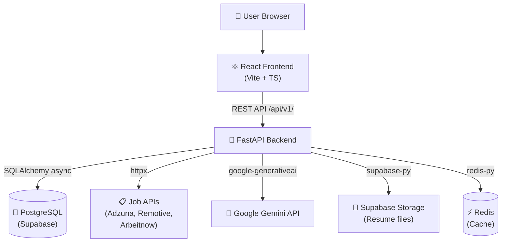
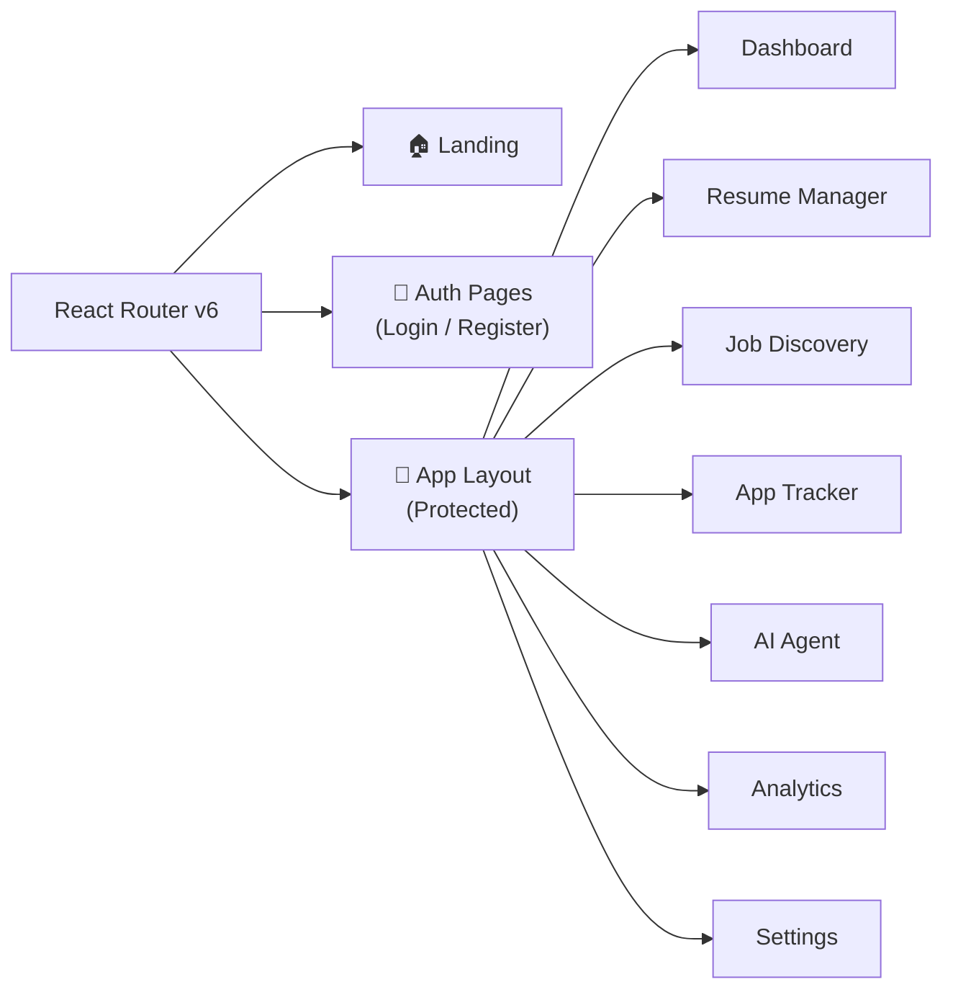
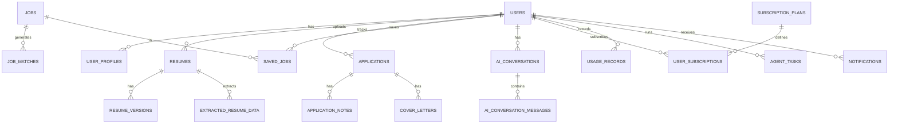
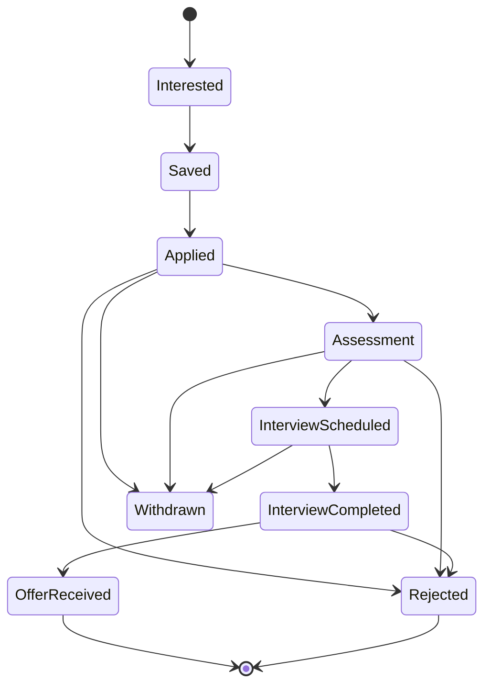
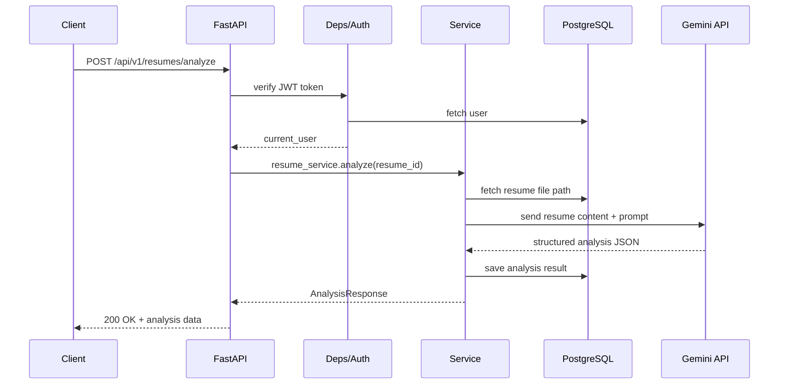

# ApplyMate AI 🤖

> **AI-powered job application assistant** that helps you find, apply for, and track jobs — all in one place.

[](LICENSE)
[](https://www.python.org/)
[](https://reactjs.org/)
[](https://fastapi.tiangolo.com/)

---

## 📋 Table of Contents

1. [Problem Statement](#-problem-statement)
2. [Features](#-features)
3. [Tech Stack](#-tech-stack)
4. [Architecture](#-architecture)
5. [Getting Started](#-getting-started)
6. [Environment Configuration](#-environment-configuration)
7. [Running the App](#-running-the-app)
8. [Testing](#-testing)
9. [Project Structure](#-project-structure)
10. [API Reference](#-api-reference)
11. [Deployment](#-deployment)
12. [Future Enhancements](#-future-enhancements)
13. [Contributing](#-contributing)

---

## 🎯 Problem Statement

Job searching is exhausting. Candidates spend hours:
- Manually tailoring resumes for each role
- Tracking applications across spreadsheets
- Writing cover letters from scratch
- Preparing for interviews without guidance
- Discovering relevant jobs across dozens of platforms

**ApplyMate AI** solves all of this with intelligent automation powered by Google Gemini.

---

## ✨ Features

### 🔍 Smart Job Discovery
- Aggregates jobs from **Adzuna**, **Remotive**, and **Arbeitnow**
- AI-powered job matching with **0–100 compatibility scores**
- Filter by role, location, salary, remote/on-site

### 📄 Resume Intelligence
- Upload PDF / DOCX resumes
- **AI parsing** extracts structured data (skills, experience, education)
- **Resume scoring** (0–100) with section-level feedback
- Version history with diff comparison

### ✍️ AI Content Generation
- **Cover letter generation** — tone-aware, contextual to job + resume
- **Resume tailoring** — optimize keywords without fabricating experience
- **Interview Q&A generation** — role-specific preparation

### 📊 Application Tracker
- **Kanban board** — drag-and-drop between status columns
- **Table view** — sort, filter, search all applications
- Status pipeline: `Interested → Saved → Applied → Assessment → Interview → Offer → Rejected`

### 🤖 AI Agent Workspace
- Conversational AI for career coaching
- Tool-calling agent that can search jobs, analyze resumes, draft documents
- Persistent conversation history

### 📈 Analytics Dashboard
- Application funnel visualization
- Skills gap analysis
- Weekly career reports
- Response rate tracking

### 🔔 Notifications
- In-app notification center
- Application status reminders
- AI-generated weekly career insights

---

## 🛠 Tech Stack

### Frontend
| Technology | Version | Purpose |
|------------|---------|---------|
| React | 18 | UI framework |
| TypeScript | 5 | Type safety |
| Vite | 5 | Build tool |
| Tailwind CSS | 3 | Styling |
| shadcn/ui + Radix UI | — | Component library |
| React Router DOM | 6 | Client-side routing |
| TanStack Query | 5 | Server state management |
| React Hook Form + Zod | — | Forms + validation |
| Recharts | — | Data visualization |
| Axios | — | HTTP client |
| DnD Kit | — | Drag-and-drop |

### Backend
| Technology | Version | Purpose |
|------------|---------|---------|
| Python | 3.11+ | Runtime |
| FastAPI | 0.100+ | API framework |
| SQLAlchemy | 2.0 | ORM (async) |
| Alembic | — | Database migrations |
| Pydantic v2 | — | Data validation |
| python-jose | — | JWT tokens |
| passlib + bcrypt | — | Password hashing |
| Google Gemini API | — | Primary AI |
| OpenAI | — | Optional AI fallback |
| Uvicorn | — | ASGI server |

### Infrastructure
| Technology | Purpose |
|------------|---------|
| PostgreSQL 16 | Primary database |
| Redis 7 | Caching + sessions |
| Supabase | Managed DB + file storage |
| Docker | Local development |

---

## 🏗 Architecture

### System Overview



### Frontend Architecture



### Database Entity Relationships



### Application Status Flow



### API Request Flow



---

## 🚀 Getting Started

### Prerequisites

- **Node.js** 18+ and npm 9+
- **Python** 3.11+
- **Docker Desktop** (for local PostgreSQL + Redis)
- **Git**

### 1. Clone the Repository

```bash
git clone https://github.com/your-username/applymate-ai.git
cd applymate-ai
```

### 2. Configure Environment

```bash
cp .env.example .env
# Edit .env with your API keys (see Environment Configuration below)
```

### 3. Start Local Services

```bash
docker-compose up -d
# Starts PostgreSQL on :5432 and Redis on :6379
```

### 4. Set Up the Backend

```bash
cd backend
python -m venv venv

# Windows
.\venv\Scripts\activate

# macOS / Linux
source venv/bin/activate

pip install -r requirements.txt

# Run database migrations
alembic upgrade head

# Start the backend server
uvicorn app.main:app --reload --host 0.0.0.0 --port 8000
```

### 5. Set Up the Frontend

```bash
cd frontend
npm install
npm run dev
# App available at http://localhost:5173
```

---

## ⚙️ Environment Configuration

| Variable | Required | Description |
|----------|----------|-------------|
| `DATABASE_URL` | ✅ | PostgreSQL connection string |
| `JWT_SECRET_KEY` | ✅ | Random secret for JWT signing |
| `GEMINI_API_KEY` | ✅ | Google Gemini API key |
| `OPENAI_API_KEY` | ⬜ | OpenAI key (optional fallback) |
| `SUPABASE_URL` | ✅ | Supabase project URL |
| `SUPABASE_ANON_KEY` | ✅ | Supabase anonymous key |
| `SUPABASE_SERVICE_KEY` | ✅ | Supabase service role key |
| `ADZUNA_APP_ID` | ⬜ | Adzuna API app ID |
| `ADZUNA_API_KEY` | ⬜ | Adzuna API key |
| `FRONTEND_URL` | ✅ | Frontend origin for CORS |
| `ENVIRONMENT` | ✅ | `development` or `production` |

> [!TIP]
> Get a free Gemini API key at [Google AI Studio](https://makersuite.google.com/). Get a free Supabase project at [supabase.com](https://supabase.com/).

---

## 🏃 Running the App

### Development Mode

**Terminal 1 — Backend:**
```bash
cd backend
.\venv\Scripts\activate   # Windows
uvicorn app.main:app --reload --port 8000
```

**Terminal 2 — Frontend:**
```bash
cd frontend
npm run dev
```

**Terminal 3 — Services (if not using Supabase):**
```bash
docker-compose up
```

Access the app at **http://localhost:5173**  
API docs at **http://localhost:8000/docs**

---

## 🧪 Testing

### Backend Tests

```bash
cd backend
.\venv\Scripts\activate
pytest --cov=app --cov-report=term-missing
```

### Frontend Tests

```bash
cd frontend
npm run test
npm run test:ui   # Vitest UI
```

---

## 📁 Project Structure

```
Ai-Jobapp/
├── .env.example                 # Environment variable template
├── .gitignore
├── docker-compose.yml           # PostgreSQL + Redis for local dev
├── README.md
├── DEVELOPMENT_STATUS.md        # Phase tracking
│
├── frontend/                    # React + Vite + TypeScript
│   ├── src/
│   │   ├── assets/              # Images, icons
│   │   ├── components/
│   │   │   ├── ui/              # shadcn/ui base components
│   │   │   ├── layout/          # App shell, sidebar, header
│   │   │   ├── auth/            # Auth-specific components
│   │   │   ├── resume/          # Resume cards, uploader
│   │   │   ├── jobs/            # Job cards, filters
│   │   │   ├── tracker/         # Kanban, table views
│   │   │   ├── agent/           # AI chat interface
│   │   │   ├── analytics/       # Charts, metrics
│   │   │   └── shared/          # Reusable across features
│   │   ├── context/             # React context providers
│   │   ├── hooks/               # Custom React hooks
│   │   ├── layouts/             # Page layout wrappers
│   │   ├── pages/
│   │   │   ├── landing/         # Public landing page
│   │   │   ├── auth/            # Login, register, forgot-pw
│   │   │   └── app/             # Protected app pages
│   │   ├── services/            # Axios API client functions
│   │   ├── types/               # TypeScript interfaces
│   │   └── utils/               # Helper functions
│   ├── tailwind.config.js
│   ├── vite.config.ts
│   └── package.json
│
└── backend/                     # FastAPI + SQLAlchemy
    ├── app/
    │   ├── api/
    │   │   └── v1/
    │   │       ├── endpoints/   # Route handlers
    │   │       └── router.py    # API router
    │   ├── agents/              # AI agent definitions
    │   ├── core/
    │   │   ├── config.py        # Pydantic settings
    │   │   ├── security.py      # JWT + bcrypt
    │   │   └── exceptions.py    # Custom exceptions
    │   ├── integrations/        # External API clients
    │   ├── models/              # SQLAlchemy models
    │   ├── repositories/        # Data access layer
    │   ├── schemas/             # Pydantic request/response schemas
    │   ├── services/            # Business logic
    │   ├── utils/               # Helpers
    │   ├── database.py          # DB engine + session
    │   └── main.py              # FastAPI app entry point
    ├── migrations/              # Alembic migrations
    ├── tests/                   # pytest test suite
    ├── requirements.txt
    └── pytest.ini
```

---

## 📡 API Reference

Interactive API docs available at **http://localhost:8000/docs** (Swagger UI) and **http://localhost:8000/redoc** (ReDoc).

### Key Endpoints

| Method | Endpoint | Description |
|--------|----------|-------------|
| `POST` | `/api/v1/auth/register` | Register new user |
| `POST` | `/api/v1/auth/login` | Login + get JWT |
| `POST` | `/api/v1/auth/refresh` | Refresh access token |
| `GET` | `/api/v1/profile` | Get user profile |
| `POST` | `/api/v1/resumes/upload` | Upload resume (PDF/DOCX) |
| `POST` | `/api/v1/resumes/{id}/analyze` | AI resume analysis |
| `GET` | `/api/v1/jobs` | List/search jobs |
| `GET` | `/api/v1/jobs/{id}/match` | Job match score |
| `GET` | `/api/v1/applications` | List applications |
| `POST` | `/api/v1/applications` | Create application |
| `POST` | `/api/v1/ai/chat` | AI agent chat |
| `POST` | `/api/v1/ai/generate-cover-letter` | Generate cover letter |
| `POST` | `/api/v1/ai/tailor-resume` | Tailor resume to job |
| `GET` | `/api/v1/analytics/dashboard` | Analytics overview |

---

## 🚢 Deployment

### Backend (Render / Railway / Fly.io)

1. Set all environment variables in the platform dashboard
2. Set start command: `uvicorn app.main:app --host 0.0.0.0 --port $PORT`
3. Run migrations on deploy: `alembic upgrade head`

### Frontend (Vercel / Netlify)

1. Set `VITE_API_URL` to your backend URL
2. Build command: `npm run build`
3. Output directory: `dist`

### Database

Use **Supabase** (recommended) or any managed PostgreSQL service.

---

## 🔮 Future Enhancements

- [ ] **Browser Extension** — 1-click job save from LinkedIn/Indeed
- [ ] **Mobile App** — React Native companion
- [ ] **Email Integration** — Parse application confirmation emails
- [ ] **LinkedIn Import** — Import profile data
- [ ] **Salary Intelligence** — Market salary insights per role
- [ ] **Referral Network** — Connect with employees at target companies
- [ ] **ATS Simulation** — Simulate ATS parsing of resumes
- [ ] **Multi-language Support** — i18n for global users
- [ ] **Team/Agency Mode** — Manage multiple candidate profiles
- [ ] **Webhook Notifications** — Slack / Discord alerts

---

## 🤝 Contributing

1. Fork the repository
2. Create a feature branch (`git checkout -b feature/amazing-feature`)
3. Commit your changes (`git commit -m 'feat: add amazing feature'`)
4. Push to the branch (`git push origin feature/amazing-feature`)
5. Open a Pull Request

---

## 📄 License

MIT License — see [LICENSE](LICENSE) for details.

---

<p align="center">Built with ❤️ using Google Gemini AI</p>
